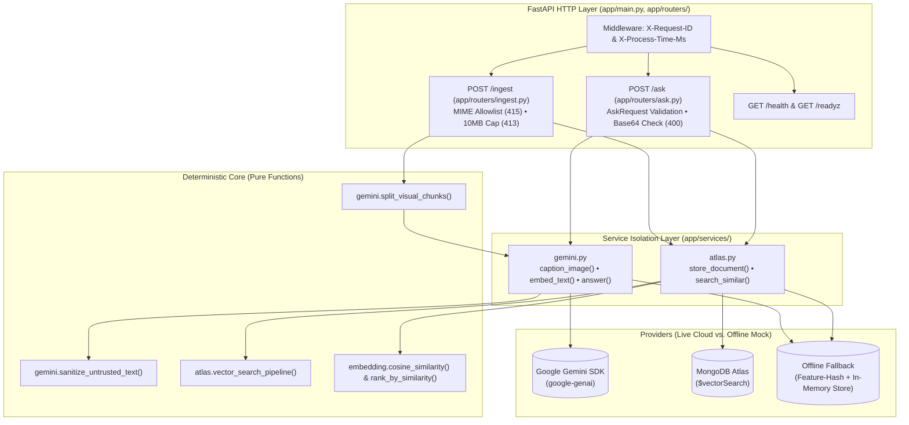

# PLANNING.md — multimodal-gemini-agent

## What this is

A FastAPI service that ingests visual documents (charts, diagrams, multi-page PDFs) and answers questions about them by combining Google Gemini's multimodal reasoning (`google-genai`) with vector retrieval over a MongoDB Atlas knowledge base.

All routes (`/ingest`, `/ask`, `/health`, `/readyz`), the Gemini service wrapper, the Atlas storage/retrieval layer, production guardrails (`413`/`415`/prompt-injection framing), and the evaluation harness (`app/eval.py`) are fully implemented with deterministic offline fallback policies (`GEMINI_MOCK=1`, `ATLAS_MOCK=1`).

## Architecture

### Module responsibilities

| Module | Path | Purpose | Status |
|---|---|---|---|
| FastAPI app & middleware | `app/main.py` | Creates app, attaches `X-Request-ID` & `X-Process-Time-Ms` middleware, exposes `/health` and `/readyz`. | Implemented |
| Evaluation harness | `app/eval.py` | Runs golden multimodal benchmark (`Recall@3`, grounding rate, guardrails, p50/p95 latency) -> `data/eval_report.json`. | Implemented |
| Ingest route | `app/routers/ingest.py` | `POST /ingest` — validates MIME/size, splits multi-page PDFs, captions, embeds, and stores. | Implemented |
| Ask route | `app/routers/ask.py` | `POST /ask` — embeds question, retrieves top-k context, invokes multimodal Gemini, returns grounded `AskResponse`. | Implemented |
| Gemini service | `app/services/gemini.py` | `caption_image`, `embed_text`, `answer`, `split_visual_chunks`, `sanitize_untrusted_text` (`google-genai` + offline policy). | Implemented |
| Atlas service | `app/services/atlas.py` | `vector_search_pipeline` (pure), `VECTOR_INDEX_DEFINITION`, `store_document`, `search_similar`. | Implemented |
| Embedding service | `app/services/embedding.py` | `cosine_similarity`, `rank_by_similarity` (pure math) and `to_vector`. | Implemented |
| Schemas | `app/models/schemas.py` | Frozen Pydantic models: `IngestRequest`, `IngestResponse`, `AskRequest`, `AskResponse`. | Implemented |
| Tests | `tests/test_suite.py` | 36 offline unit/integration tests + 1 `@pytest.mark.live` test. | 36 passing, 93%+ coverage |
