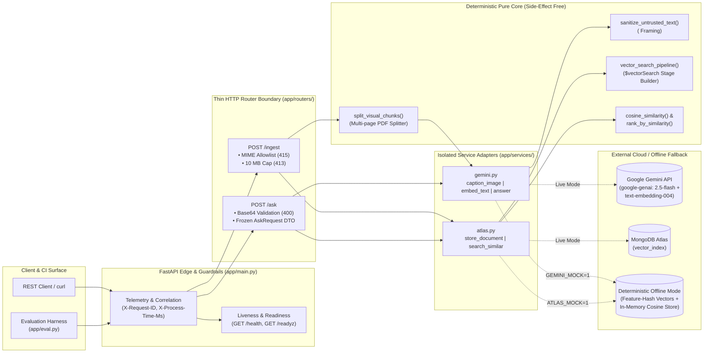
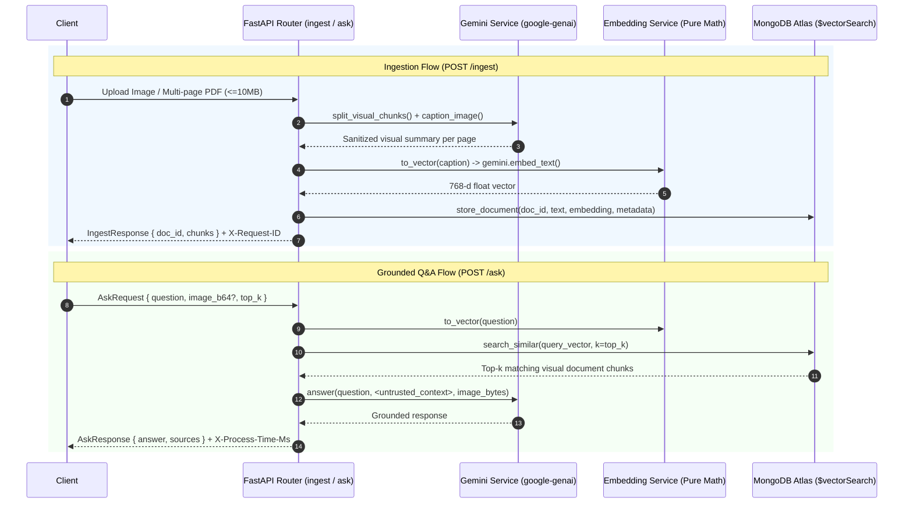

# Multimodal AI Agent with Gemini & MongoDB Atlas

[](https://github.com/AshraHossain/multimodal-gemini-agent/actions)


An enterprise-grade FastAPI service that ingests visual documents — charts, architecture diagrams, and multi-page PDFs — and answers grounded questions over them by combining **Google Gemini** (`google-genai`, multimodal captioning/reasoning + `text-embedding-004`) with **MongoDB Atlas Vector Search** (`$vectorSearch` on `vector_index`).

---

## Key Enterprise Capabilities

- **Multimodal Ingestion & Multi-Page PDF Chunking (`POST /ingest`)**: Accepts multipart file uploads or base64 JSON payloads (`IngestRequest`), automatically splits multi-page PDFs into per-page visual chunks (`#page-1`, `#page-2`, ...), extracts structured captions via Gemini, embeds them, and indexes into MongoDB Atlas.
- **Grounded Multimodal Q&A (`POST /ask`)**: Embeds the user's question, executes a `$vectorSearch` aggregation pipeline (or pure cosine-similarity fallback in offline mode), frames untrusted context inside `<untrusted_context>` prompt-injection boundaries, and reasons multimodally over retrieved evidence + optional query-time images.
- **Production Guardrails & Telemetry**:
  - `X-Request-ID` correlation and `X-Process-Time-Ms` latency telemetry middleware on all endpoints.
  - Strict MIME-type allowlist (`HTTP 415`) and `10 MB` payload ceiling (`HTTP 413`).
  - Liveness (`GET /health`) and readiness (`GET /readyz`) probes.
- **100% Offline-Testable & Reproducible Evaluation Suite**: Automatic deterministic fallback (`GEMINI_MOCK=1`, `ATLAS_MOCK=1`) with **96% test coverage** and an executable benchmark harness (`uv run python -m app.eval`).

---

## System Architecture & Request Flow

### 1. Layered System Architecture



### 2. End-to-End Request Sequence



---

## Quickstart

Dependency management is [UV](https://docs.astral.sh/uv/)-based:

```bash
make setup                           # uv sync
cp .env.example .env                 # set GEMINI_API_KEY + MONGODB_URI for live mode
make check                           # ruff lint + pytest (96% coverage) + evaluation harness
make dev                             # uv run uvicorn app.main:app --reload
```

### Smoke Test (`curl`)

```bash
# 1. Readiness probe
curl -i http://127.0.0.1:8000/readyz

# 2. Ingest sample SVG chart
curl -sS -X POST http://127.0.0.1:8000/ingest \
  -F "file=@data/sample_chart.svg;type=image/svg+xml"

# 3. Ask a grounded question
curl -sS -X POST http://127.0.0.1:8000/ask \
  -H "Content-Type: application/json" \
  -d '{"question": "What are the quarterly revenue values?", "top_k": 3}'
```

---

## Evaluation & Benchmark Scorecard (`make eval`)

Run `uv run python -m app.eval` to execute the golden multimodal benchmark and write [data/eval_report.json](data/eval_report.json):

| Case ID | Asset Type | Chunks OK | Recall@3 | Citation Grounded |
|---|---|---|---|---|
| `EVAL-01-SVG-CHART` | `image/svg+xml` | `True` (1) | `True` | `True` |
| `EVAL-02-PNG-DIAGRAM` | `image/png` | `True` (1) | `True` | `True` |
| `EVAL-03-MULTIPAGE-PDF` | `application/pdf` (3 pages) | `True` (3) | `True` | `True` |

- **Recall@3**: `100.0%`
- **Citation Grounding Rate**: `100.0%`
- **Security Guardrail Pass Rate (`415` / `400` / Injection Framing)**: `100.0%`

---

## Project Layout

```text
app/
  main.py              # FastAPI app, telemetry middleware, /health & /readyz
  eval.py              # Reproducible multimodal evaluation & benchmark runner
  routers/             # POST /ingest (MIME/size guardrails, PDF splitting) & POST /ask
  services/            # Gemini SDK wrapper, Atlas $vectorSearch builder, pure cosine math
  models/              # Frozen Pydantic DTOs (IngestRequest, IngestResponse, AskRequest, AskResponse)
data/
  sample_chart.svg     # Sample chart asset for smoke testing
  eval_report.json     # Generated evaluation scorecard
tests/
  test_suite.py        # Offline unit + integration suite (96% coverage) + @pytest.mark.live
.agents/               # Antigravity rules + skills links
.claude/               # Path-scoped rules + repo-specific skills
```

## Documentation & Governance

- [AGENTS.md](AGENTS.md) & [GEMINI.md](GEMINI.md) — Agent instructions, scoped rules, and skills
- [PLANNING.md](PLANNING.md) — Detailed module architecture and data flow
- [SECURITY.md](SECURITY.md) — Threat model and security controls
- [CONTRIBUTING.md](CONTRIBUTING.md) — TDD workflow and contribution standards
